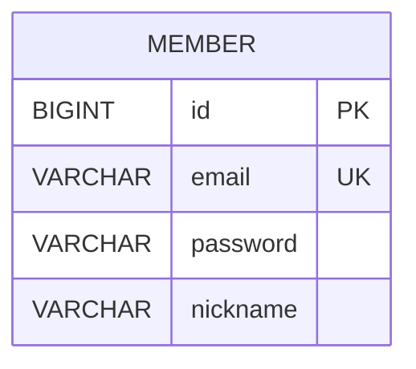

# DB 명세

## ERD

## member
| 컬럼 | 타입 | NULL | 키 | 설명 |
|---|---|---|---|---|
| id | BIGINT AUTO_INCREMENT | N | PK | 회원 식별자 |
| email | VARCHAR | N | UK | 이메일. 중복 불가. 길이 결정 필요 D1 |
| password | VARCHAR | N | | 비밀번호. 저장 방식·길이 결정 필요 D2 |
| nickname | VARCHAR | N | | 닉네임. 길이 결정 필요 D3, 유니크 여부 결정 필요 D4 |
