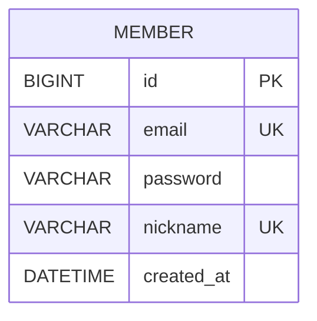

# DB 명세

## ERD

## member

| 컬럼 | 타입 | NULL | 키 | 설명 |
|---|---|---|---|---|
| id | BIGINT AUTO_INCREMENT | N | PK | 회원 식별자 |
| email | VARCHAR(100) | N | UK | 이메일. 중복 불가. 대소문자 구분 안 함(소문자로 저장) |
| password | VARCHAR(60) | N | | 비밀번호. 입력(4~20자) 평문을 BCrypt 로 단방향 해시한 값(60자)을 저장 |
| nickname | VARCHAR(20) | N | UK | 닉네임. 중복 불가 |
| created_at | DATETIME | N | | 회원가입 일시 |
