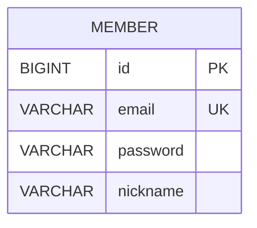

# DB 명세

## ERD

## member

| 컬럼 | 타입 | NULL | 키 | 설명 |
|---|---|---|---|---|
| id | BIGINT AUTO_INCREMENT | N | PK | 회원 식별자 |
| email | VARCHAR(255) | N | UK | 이메일. 중복 불가. 길이 `결정 필요 D4`, 대소문자 `결정 필요 D5` |
| password | VARCHAR(255) | N | | 비밀번호. 저장 방식 `결정 필요 D6` |
| nickname | VARCHAR(50) | N | | 닉네임. 중복 허용 `결정 필요 D2`, 길이 `결정 필요 D4` |
